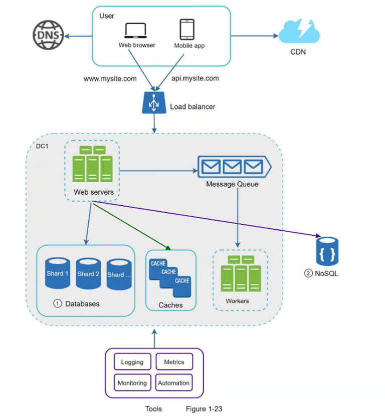

# Notas que he considerado útiles refrescar la memoria sobre o directamente no conocía.

## Capítulo 1: De 0 a millones de usuarios

- DNS convierte dominio en IP, a esa IP se le solicita un GET HTTP de la página (a su servidor web)
- Conforme crece la base de usuarios, necesitamos un servidor para la capa web, y otro para la base de datos.
- SQL significa base de datos relacional, las más populares son Postgres, MySQL y Oracle. SQL permite realizar operaciones de unión, cosa que las NoSQL como MongoDB no permite.
- Una NoSQL es correcta cuando una app requiere latencia ultrabaja, no dispone de datos estructurados o relacionales (por ejemplo casos en los que hay un objeto usuarios que a veces algun usuario tiene campo rol, otras veces no, estas variaciones de un mismo objeto generan en una SQL tablas adicionales o cambios en el esquema, es util si se necesita menos rigidez y consistencia en los campos de los objetos) o cuando necesitas almacenar una gran cantidad de datos ya que complica el escalado de tamaño de forma horizontal, si tenemos un servidor con 1TB de almacenamiento y necesitamos más tamaño porque tenemos demasiados datos, es más sencillo y escalable, comprar otro servidor de 1tb de almacenamiento, que mejorar el actual a 2tb, ese escalado horizontal tb se puede hacer en sql, pero resulta más dificil a gran escala la comunicación entre las tablas cuando estan en distintos servidores.
- Balanceador de carga se introdujo debido al aumento de usuarios, para balancear los usuarios entre los diferentes servidores cuando fuese necesario y para que si un servidor falla haya otros disponibles.
- Al igual que hacemos varios servidores para correr las instancias de nuestra web/app, de nada sirve si no escalan las bases de datos, existe la replicación de bases de datos, una base de datos maestra, la cual recibe los writes, y varios clones esclavos a los que llegan los read. Esto aporta rendimiento, seguridad (al tener varias replicas en distintas localizaciones) y más uptime. En este caso tambien hay balanceadores de carga, que se encargan de que si cae la maestra, una escalva pase a ser maestra, y si cae una esclava pues se redirigen las peticiones a las demás mientras que se reemplaza.
- Para mejorar los response times, se crea la caché, implementaciones de caché conocidos es cache-aside, on cache miss la db devuelve a la app el valor y la app la escribe en cache, y read-through que es la db la que escribe en cache cuando hay cache-miss (ambos son buenos cuando hay muchos read operations). Hay otros modelos de cache para cuando el write load es heavier, pero no los tratamos aqui.
- Mejor usar almacenamiento en caché cuando los datos se leen con frecuencia pero no se modifican con frecuencia, implementar politica de caducidad es una beuna practica obvio, un unico servidor de cache. como siempre, implica un unico punto de fallo, asi que evidentemente mejor varios servidores de caché, si una cache esta llena, cualquier solicitud que nitente meter contenido debe eliminar un elemento anterior, usualmente se hace la eliminacion del elemento menos usado recientemente, aunque existen otras que eliminan el menos usado en general, o FIFO.
- CDN es una red de servidores distribuidos geográficamente para servir contenido estático, imgs, videos, .css y .js. Entras a https://mysite.cloudfront.net/logo.jpg y se busca en el CDN más cercano, si no está en la caché del CDN pues ya el CDN solicita el archivo al servidor origen y lo guarda en su cache segun el TTL.
- Cuando tienes centros de datos en distintas geolocalizaciones hay herramientas como GeoDNS que redirige el tráfico al centro de datos más cercano al usuario.
- Debido al desaclomaiento, las colas de mensajes es la arq prefeida para crear apps escalables y fiables, para que el emisor pueda enviar mensajes al subscriptor incluso cuando el emisor ya no está disponible.
- Conforme crecen los datos, se requiere ampliar/extender la base de datos, que es lo que hablamos antes de escalado vertical o escalado horizontal, como hemos dicho, el vertical es más caro, limitado, y un solo punto de fallo. Menciona por encima el sharding, y las claves de fragmentación en la que se decide por ejemplo userid % 4 como clave para decidir a que shard mandar la informacion de ese usuario y a la cual las peticiones sobre ese user se dirigirán. Aunque hay complejodades con celebridades que se hará muchos más fetches por ejemplo.

- Conclusión, lo aprendido en este capítulo asentará unas bases para que podamos superar el millón de usuarios, es imprtante entender bien estas bases, para poder entender las complicaciones futuras.

## Capítulo 2: Estimación aproximada
- En las entrevistas de diseño de sistemas, en ocasiones se pide que se utilicen estimaciones para calcular requisitos de capacidad o rendimiento de un sistema, para ello es necesario comprender bien los fundamentos de escalabilidad. Para ello es importante conocer la diferencia de tiempo que conlleva acceder a una caché L1 ni un nanosegnudo, una caché L2, 7 nanosegundos, o acceder a disco que asciende a milisegundos, y enviar 2KB en una red de 1GBPS pues te lleva unos 50nanosegundos. Enviar desde California a Holanda son 150ms, de una punta a otro del mundo.
- La mayoría de los servicios tienen una disponibilidad entre el 99 % y el 100 %, Amazon, Google y Microsoft establecen que debe haber un uptime de 99.9%.
- En este capitulo te intenta enseñar a pensar rápidamente cuanto puede pesar algo como por ejemplo un tweet, max 140 caracteres, por lo tanto 140 bytes, mas id, 64 bytes más, si incluye archivo, 1MB, se hacen unos 150 millones de tweet al día por ejemplo pues calculas una media de fotos mas caracteres y estimas, 30TB de writes al día, y a partir de ahí tomas decisiones, es importante que tengas un proceso mental lógico al hacer estos calculos, aunque el resultado no sea el ás preciso. Ejemplo twitter, usuarios activos diarios, 300 millones, 150 lo usa a diario y sube 2 posts de media, hay qeu estimar las QPS, una metrica ampliamente usada, queries per second, 150 millones * 2 diarios, entre 24 horas, entre 3600 segundos en cada hora, aprox 3500. osea que se podría pensar que un QPS máximo en un día ajetreado podría ser de 2*3500, 7000 queries per second.